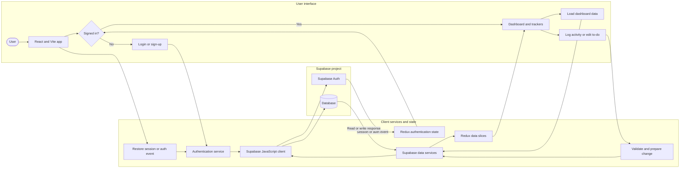
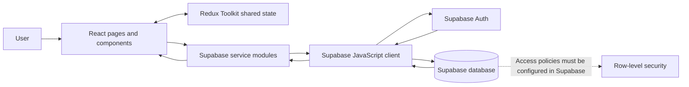
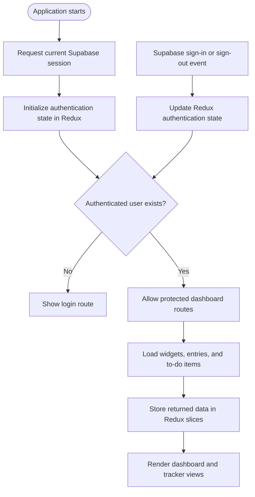
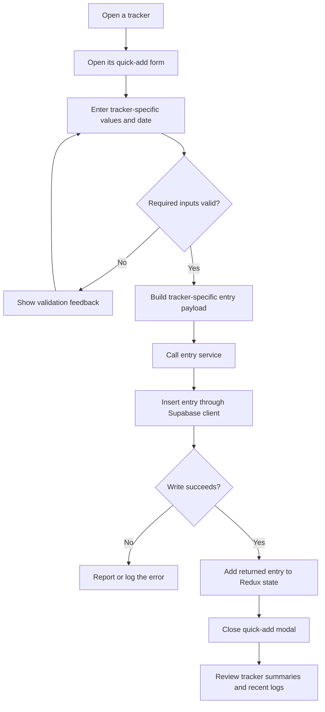
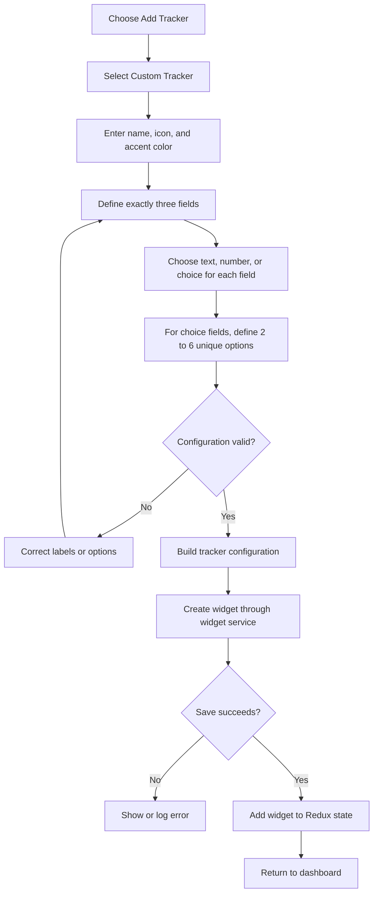
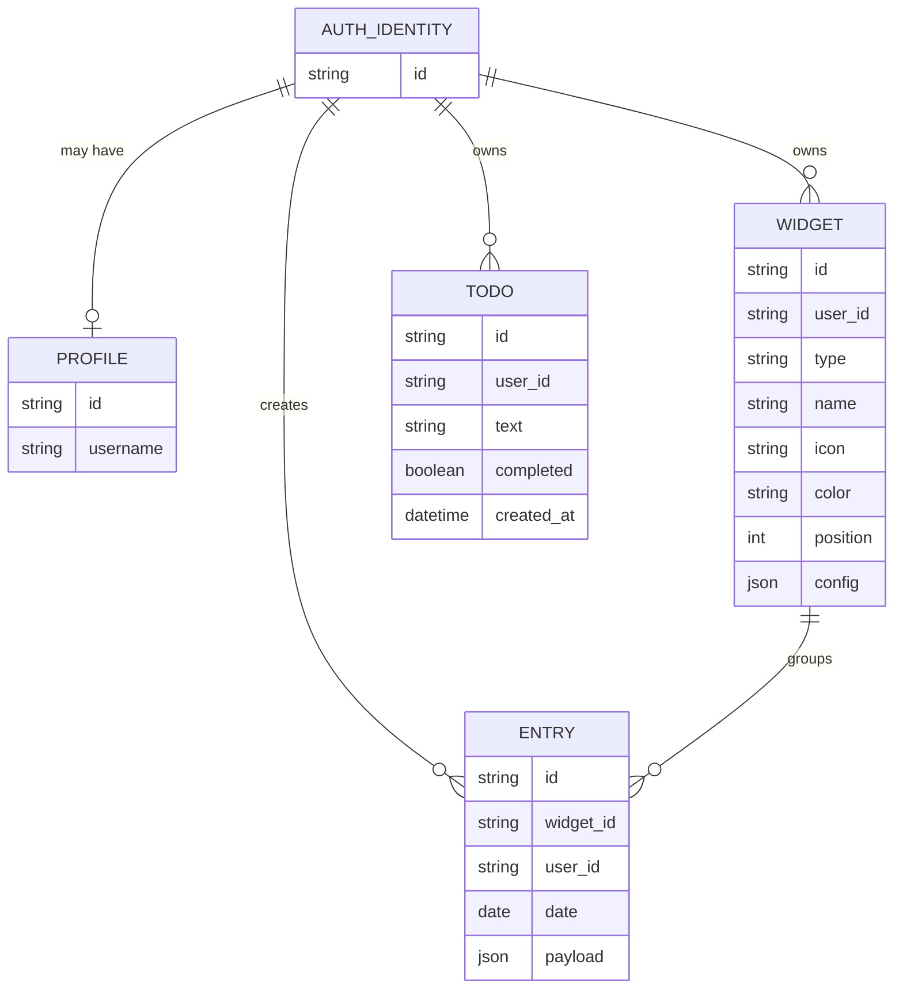

# SyncSpace diagrams for the project report

This guide contains Mermaid source for diagrams that match the implementation in the SyncSpace repository. Put the diagrams in Chapter 4 of Project_Report.docx, at the locations below. Mermaid code does not render automatically inside Word: render each block to SVG or PNG, then insert the image and its caption. Alternatively, recreate it with editable Word shapes.

## Recommended placement

| Figure | Diagram | Insert in the report |
|---|---|---|
| Figure 4.1 | Client architecture and data flow | Chapter 4, section 4.1 **System Architecture** (currently page 15). Replace the existing single-column “Architecture flow” table with this diagram. Keep the layer responsibilities table beneath it. |
| Figure 4.2 | Authentication and dashboard access | Chapter 4, section 4.2 **Application Startup and Authentication Flow** (currently page 15). Use it in place of the numbered text sequence, or put it immediately after that sequence. |
| Figure 4.3 | Activity logging workflow | Chapter 4, section 4.5.2 **Activity Logging Workflow** (currently page 17). Place it after the explanatory paragraph. |
| Figure 4.4 | Custom tracker creation | Chapter 4, section 4.5.3 **Custom Tracker Workflow** (currently page 17). Place it after the explanatory paragraph. |
| Figure 4.5 | Logical data model | Chapter 4, section 4.6 **Logical Data Model** (currently page 17). Place it after the opening paragraph and before the existing records table. |

Page numbers refer to the current report and may shift after figures are inserted; use the section headings as the stable locations.

Use the captions shown below. After inserting, update the table of contents in Word. If you add a list of figures, number it consistently with the figure captions.

## Master flow diagram for the PowerPoint

Use this overview diagram on a slide titled **System Architecture and Data Flow**. Place it after the project overview or problem/objectives slides and before the detailed module slides. It summarizes authentication, dashboard data loading, user actions, persistence, and the Redux updates that refresh the interface.

**Suggested slide caption:** SyncSpace authentication, data access, and dashboard update flow.

**Accuracy note:** Authentication and database access use Supabase client services from the browser; the repository does not contain a separate application server. The database schema and row-level security policies must be configured in the Supabase project. The flow is request/response based and does not imply Supabase Realtime subscriptions.

## Figure 4.1 Client architecture and data flow

**Caption:** Figure 4.1. SyncSpace client architecture and data flow.

**Accuracy note:** The application calls Supabase from its browser client. The repository does not include a separate application server or the database policies. The dashed policy note is an external configuration requirement, not a component implemented in the repository.

## Figure 4.2 Authentication and dashboard access

**Caption:** Figure 4.2. Authentication initialization and protected dashboard flow.

**Accuracy note:** The flow reflects App.jsx, the route guard, and dashboard loading. It does not describe server-side authorization; database access still depends on configured Supabase policies.

## Figure 4.3 Activity logging workflow

**Caption:** Figure 4.3. Activity entry submission and client state update.

**Accuracy note:** Error presentation differs between forms. The diagram should not be labeled “real-time synchronization”: the inspected source uses request/response service calls and does not subscribe to Supabase Realtime channels.

## Figure 4.4 Custom tracker creation

**Caption:** Figure 4.4. Custom tracker setup and saving workflow.

**Accuracy note:** Field labels must be non-empty and unique; reserved shared-field labels are rejected. Choice options must be unique, with 2 to 6 options. Shared tracker fields such as date, duration, rating, and notes are separate from the three custom fields.

## Figure 4.5 Logical data model

**Caption:** Figure 4.5. Logical records and relationships inferred from SyncSpace client service calls.

**Accuracy note:** The repository does not include SQL migrations or a database schema. This is a logical model inferred from the fields used by the client. Verify exact table names, constraints, foreign keys, and row-level security policies against the Supabase project before presenting it as the implemented database schema.

## Rendering and insertion

1. Copy one Mermaid block into a Mermaid-compatible renderer and export it as SVG or PNG.
2. In Word, insert the exported image at the placement listed above and center it within the text margins.
3. Add the supplied caption directly below each image. Keep the image and caption together on the same page.
4. Update the Word table of contents after inserting diagrams. A list of figures is optional because the reference report does not include one.
5. Check that labels remain readable at normal page zoom. If needed, use a portrait layout for the workflow diagrams or split a dense diagram into separate figures.
